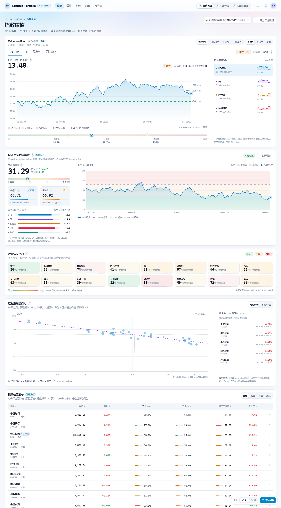
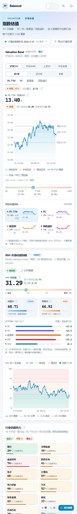

# V1 · Prologue Refined

> 全站 UI/UX 重构的**推荐基线变体**：在用户已选原型的结构语言（d1 / stockA / basketA / cryptoB）上注入 prologue.dev 的质感（玻璃顶栏、品牌柔光、spotlight hover、pill 分段、mono 数字、局部 Skeleton + reveal-rise）。
>
> 交付物为**单文件静态高保真原型**：A 指数估值首页 / B HSI 详情 / C Dashboard（四象限 + 一篮子），无外部依赖、无 CDN、无网络请求，所有图表为内联 SVG。数据为 2026-11-27 真实快照 + 明确标注的合理 mock。

## 1. 快速查看

- 入口：直接用浏览器打开 [index.html](./index.html)（Chrome / Edge / Safari 均可）。
- 三个屏幕：右上角 A 估值首页 / B HSI 详情 / C Dashboard，或 URL hash：
  - A: #/valuation
  - B: #/valuation/HSI
  - C: #/dashboard
- 右下角浮层：**明 / 暗**切换 + **演示加载**（重播每卡片独立 1.2s Skeleton）。
- 页面内可交互：指标切换、指数/窗口切换、MVI 展开大图、红利模式切换、表格排序、基金展开/排序、Dashboard 模式切换、组合下拉、复制篮子提示、空态。
- 仅用于视觉/交互评审的 QA 参数（不影响正常浏览）：?theme=dark|light、?screen=B|C、?modal=mvi、?debug=1。

## 2. 设计 Token

### 2.1 颜色（浅色 / 暗色）

| Token | 浅色 | 暗色 | 用途 |
|---|---|---|---|
| bg | #f6f8fb | #0b1220 | 页面背景 |
| surface | #ffffff | #111a2b | 卡片 / 面板 |
| surface-2 | #f2f6fa | #16213a | segmented 底 / 表头 / 次级填充 |
| border | #e4e9f0 | #22304a | 1px 分隔；hover 用 border-strong |
| text / text-2 / text-3 | #0f172a / #5b6b82 / #8a99ad | #e6edf7 / #a6b4c9 / #6d7c93 | 主 / 次 / 弱化文字 |
| accent（sky） | #0284c7 | #38bdf8 | 主按钮、选中、链接、主图表线 |
| accent-strong | #0369a1 | #7dd3fc | 强调文字 / info |
| up（A 股红涨） | #dc2626 | #f87171 | 仅方向性上涨 / 正收益 |
| down（A 股绿跌） | #16a34a | #4ade80 | 仅方向性下跌 / 负收益 |
| warning | #d97706 | #fbbf24 | 数据滞后、TE 偏高、中性偏高 |
| violet | #8b5cf6 | #a78bfa | 次系列（PB / 基准 / 回归线） |
| brand gradient | linear-gradient(115deg, #c7d2fe, #bae6fd 45%, #fbcfe8) | 同色低透明度 | 仅 hero 光晕、logo、强调条 |

语义色纪律：涨跌色只用于方向性数据；「低估/中性/高估」使用 success / warning / destructive 语义色（与涨跌色分开实现，暗色下单独覆盖）；四象限沿用 warning / destructive / success / 灰蓝。

### 2.2 形状 / 阴影 / 动效

| Token | 值 | 说明 |
|---|---|---|
| radius-control | 10px | 按钮、输入、segmented 内块 |
| radius-card | 14px | 数据卡片 |
| radius-panel | 20px | modal / 大浮层 |
| radius-pill | 999px | nav pill、chip、badge |
| shadow-card | 0 1px 2px rgba(15,23,42,.04), 0 8px 24px -18px rgba(15,23,42,.16) | 默认卡片（轻投影，不扁平化） |
| shadow-card-hover | 0 18px 44px -24px rgba(15,23,42,.30) | 卡片 hover 抬升 |
| shadow-pop | 0 24px 64px -24px rgba(15,23,42,.32) | 下拉 / modal / tooltip |
| dur-fast / base / enter | 150 / 200 / 300ms | 控件 / 卡片 / 入场 |
| ease | cubic-bezier(.16,1,.3,1)（expo-out） | 全部交互与入场 |
| glass header | 背景 76% 透明 + backdrop-blur(16px) | 60px sticky，滚动后加轻阴影 |

### 2.3 字体与数字

- 字体栈：系统 sans（-apple-system / Segoe UI / PingFang SC / Microsoft YaHei），**不引入任何 web font**；数字与图标使用系统 mono 栈（Geist Mono → Cascadia Mono → Menlo 回退），符合零外部依赖要求。
- 字号：正文 13.5px；表格 12px；辅助 11-11.5px；micro 9-10px；页面标题 26px；卡片标题 13.5px；KPI 大数字 26-40px；仅 hero / 估值大数字使用 40px。
- 所有数字 font-variant-numeric: tabular-nums + mono；表格数字右对齐、单位缩小、货币/百分比统一两位小数（分位一位小数）。
- 大标题 letter-spacing -0.02 ~ -0.035em；中文正文 1.55 行高。

## 3. 页面与结构

### A · /valuation 指数估值首页

1. 页头 + **DataFreshnessBadge**：绿色脉冲点「行情数据更新至 2026-11-27 · 8/8 完成」，hover/click 展开 8 类数据明细（A股 / 港股 / ETF / 基金净值 T-1 / 期货 / 指数行情 / 指数估值 / MVI），含完成时间与 T-1 口径说明。
2. **Valuation Band 核心卡**（d1 继承：左图右栏）：4 指数 segmented（默认沪深300）+ 3 窗口 + 4 指标 tabs；左侧大数字 + 分位 badge + 分位带主图 + 机会/中位/危险 gauge；右侧 4 个 mini sparkline + 分位，点击切 tab。**切换指标仅数值/曲线 150ms 交叉淡入，无整卡 loading、不重新请求**（原型以本地数据模拟一次数据包）。
3. **MVI 卡**：31.29 / 低估 / 估值分 68.71 / 风险分 66.92；双 info 按钮 hover 显示公式（估值分五因子 16.86/19.27/28.53/23.47/11.88 权重、104 周滚动、in-sample 声明；风险分 = 波动 55% + 回撤 45%）；5 因子贡献条；近 5 年平滑周频走势 + 分位带；「打开图表」弹 modal 双轴大图（MVI 左轴渐变面积 / 指数右轴、4 指数切换、十字线 tooltip）。
4. **行业估值热力**：16 个一级行业 2×8 方格，颜色映射 PE 近 5 年分位均值（绿=便宜 / 红=贵），每格显示行业 + 分位 + 样本数；hover / click 显示公式、样本数与代表指数；右上角低估/中性/高估计数。
5. **红利指数吸引力**：绝对估值（PB 对数轴 × 股息率，气泡=规模，对数回归线 + 动态 R²，中位十字线）↔ 相对估值（PB 分位 × 股息率分位，四象限底色 + 中位线），右侧 Top 5 列表随模式切换；30 个 mock 指数点位，hover 显示名称/代码/PB/股息率/规模。
6. **指数估值清单**：10 行简化表格（指数/代码、收盘、当日、PE/PB/股息率分位、近 1 年收益），表头排序、分类过滤、行 hover、行点击进入 B 页（示例）；红涨绿跌。

### B · /valuation/HSI 恒生指数详情

- 头部：恒生指数 HSI、港股 / 82 只成分 / 价格指数 / 港元标签、24,586.32 +0.82%（红涨）与 HKT 时间。
- 4 张 MetricCard（PE 11.2 / 35%、PB 1.05 / 29%、股息率 3.41% / 68%、风险溢价 4.92% / 61%），每卡带 5 年分位轨道 + 中位/低高值。
- 估值与点位双轴图：PE 左轴（sky） + 点位右轴（amber 虚线），近 10 年 / 近 5 年切换，机会/中位/危险参考线，**分位带开关**，十字线 tooltip。
- 跟踪基金：右上规模合计 1,274 亿 + 数据截至 2026-11-23 + 更新于 2026-11-27 21:10；Top 10 规模 SVG 条形图（按 TE 着色，含坐标轴/网格/图例/hover）；表格 10 行 + 展开全部 13 只、列可排序、TE>5% warning（SH513660 修复后 4.31%，另两只 warning 演示）、hover 行高亮。
- 成分/行业：**统一空态卡**「成分股权重数据建设中」+ 说明 + 订阅/反馈行动，不显示空表格骨架。
- 收益与风险卡：1Y/3Y/5Y 切换、年化收益/波动/回撤/Sharpe/累计/下行波动 + SVG 分组柱状图。
- 脚注：估值、点位、基金净值 acc_nav、TE 1Y、HSI 全收益近似口径与更新时间。

### C · /dashboard 四象限 + 一篮子资产

- **整行居中模式条**：四象限组合 / 一篮子资产 pill tabs；右侧保存/新建按钮位置固定，不随模式跳动。
- 四象限：居中组合下拉（348px，含最近更新日）、KPI 5 卡（9.2% / 7.8% / 1.18 / -12.4% / 1.46）、净值 vs 60/40 基准、2×2 四象限矩阵（权重/资产 chips/收益贡献，hover 展开明细）、当前持仓表（类别/权重/风险贡献/再平衡动作）。
- 一篮子：示例「A股核心资产 12 只」+ 我的篮子（游客 → 登录空态）；标签 示例 · 只读 · 可复制；KPI、净值、行业风险贡献堆叠条 + 图例、12 只持仓表；复制按钮点击出现「需登录」提示。
- 局部 loading：KPI / 图表 / 表格 / 象限各自 Skeleton；禁止整页 loading。

## 4. 组件清单（原型已实现）

按钮（primary / secondary / ghost / sm / icon）、segmented（sm/lg/pill）、tabs、pill badge（low/mid/high/sky/violet/muted/warn）、info 按钮、chip、状态徽标 + popover、tooltip（静态公式 + 图表十字线 + 热力 + 表格）、KPI 卡、sparkline、MetricCard、表格（排序/展开/行 hover/移动端列裁剪）、空态、Skeleton 五类（band / chart / table / kpi / 象限）、modal、dropdown、dock、focus-visible ring、skip link。

## 5. 动效与 Loading 策略

- 卡片内容独立 Skeleton：每卡 1.2s + 90ms stagger 后换回真实内容并 reveal-rise（opacity 0→1 / translateY 8→0，300ms expo-out）；**页头、布局、导航从不 skeleton**。
- 「演示加载」按钮按当前状态重新捕获 live DOM → 逐卡骨架 → 还原，验证局部 loading 不阻塞、不跳布局。
- 指标/指数/窗口切换：数值与图表内容 150ms 淡入淡出，无 skeleton、无网络请求语义；卡片 head 的 segmented/tabs 始终可点。
- 卡片 hover：translateY(-1px) + 阴影 + spotlight 径向柔光（pointer 坐标驱动的 --spot-x/--spot-y）；按钮/行/单元格 hover 完整。
- 图表：入场不做逐点动画（避免闪烁），使用一次性 reveal；折线用平滑二次路径；hover 十字线实时定位。
- prefers-reduced-motion：全部动画/过渡降到 0.01ms。

## 6. 响应式与暗色

- 断点：>1240 桌面（12 列视觉节奏）；900-1240 隐藏站点 nav、KPI 3 列；680-900 双列 / 收窄；≤680 单列、按钮全宽、模式条可横滑、表格隐藏次要列（收盘/当日/PB/股息率/基金公司等），页面级 **零横向滚动**（CDP 实测 docWidth = innerWidth：1440/390）。
- 移动端：treemap/散点/条形图按容器宽度重算像素尺寸（不是 viewBox 缩放压字），x 轴标签数量 3/4/5 自适应；图表 tooltip 跟随鼠标/触摸位置。
- 暗色：独立 token 覆盖（背景更深、边框更弱、阴影更重、涨跌色提亮）；所有图表通过 CSS 变量/class 适配，无写死浅色；品牌光晕在暗色下降低透明度。
- 可访问性：语义标题、表格 scope、按钮 aria-selected/aria-pressed/aria-expanded、图表 role=img + aria-label、focus-visible 2px sky ring、键盘 1/2/3 切屏、Esc 关 modal / 下拉 / tooltip。

## 7. 与 prologue.dev 的借鉴点

1. **三级圆角 + pill**：10 / 14 / 20 + 999 与 prologue 的 control / card / panel / pill token 同构。
2. **glass sticky header**：76% 背景 + blur(16px)，滚动后阴影渐显。
3. **柔和品牌渐变**：仅出现在 logo、hero 光晕、空态图标、KPI 背景 wash；不大面积使用。
4. **card spotlight hover**：径向柔光随指针移动 + 抬升 + 边框增强。
5. **pill 导航 / chips / info 圆钮 / 分段控件**的密度与触感。
6. **reveal-rise 入场**与 skeleton shimmer 的节奏。
7. mono 数字 + tabular-nums 的数据专业感。

## 8. 与用户偏好 d1 / stockA / basketA / cryptoB 的继承

- **d1（详情左图右栏）**：估值分位带「左图 + 右侧指标栏」（A2）、HSI 详情「指标条 + 主图 + 下方双栏」（B）。
- **stockA（行内复权表格）**：A6 清单与 C 持仓表采用紧凑行内控件/排序，数字 mono 右对齐，15-16px 行高密度。
- **basketA（表格型一篮子）**：C 的一篮子模式沿用「选择器 + KPI + 净值 + 风险贡献 + 表格」路径，不另起视觉语言。
- **cryptoB（三栏合约详情）**：B 页采用「左侧标题/报价 + 中部主图 + 右侧/下方信息卡」的层级节奏；C 的 KPI + 主图 + 表格同屏呈现。
- 保留 sky 主色、13-14px 正文、白卡片、左栏式图表、segmented、mini panel 语言。

## 9. 数据快照（2026-11-27）

- 沪深300：PE 13.40（5y 分位 42%）、PB 1.38（38%）、股息率 3.20%（61%）、ERP 5.10%（55%）——与 content-spec 一致。
- MVI：31.29（低估）、估值分 68.71、风险分 66.92；MVI = 100 − 估值分（便宜度）；风险分独立展示。
- HSI：24,586.32 +0.82%；PE 11.20（35%）、PB 1.05（29%）、股息率 3.41%（68%）、ERP 4.92%（61%）；跟踪基金 top10 规模合计 1,274.0 亿；TE 为 2.41%-6.82%，其中 SH513660 = 4.31%、TE>5% 两只以 warning 演示。
- Basket：12 只权重合计 100%，12 只名称与 content-spec 完全一致（茅台/宁德/招行/平安/五粮液/美的/长电/紫金/比亚迪/恒瑞/隆基/海天）。
- 图表历史序列、基金公司/经理、行业样本数、组合净值等为视觉评审用的确定性 mock（种子随机、无尖刺）；所有可得 spec 数字已硬编码。

## 10. 验证记录

- Chrome 157 headless（CDP 驱动）三屏 × 明暗 × 桌面/移动截图，**JS exception = 0**。
- 局部 loading：演示加载后 .card-body.is-loading 从 5 → 0（1.2s + stagger），布局不跳。
- 交互回归（CDP 自动点击）26 项全部通过：A 指标/指数/窗口切换、红利模式、表格排序、暗色、演示加载、MVI modal 开关与指数切换、B 分位带/窗口/基金展开/排序/区间、C 组合下拉/模式切换/复制提示/登录空态/返回四象限、hash 路由。
- 响应式：docWidth = innerWidth（1440/390），移动端无页面级横向滚动；内部表格列在移动端做列裁剪而非撑破页面。
- 截图：screenshot-desktop.png 1440×2600；screenshot-mobile.png 390×2600（Chrome headless 最小窗口 500px，移动端用 CDP Emulation 固定 390 CSS px 后取图，确保真实移动布局）。

## 11. 可调整取舍（建议评审时确认）

1. **天空蓝 vs 品牌紫**：sky 保持主色，但 hover 光晕带 lavender→pink；如果希望更「金融冷静」可把 spotlight 光晕进一步降到 50% 不透明度。
2. **数字字体**：零依赖下无法内置 Geist Mono，当前回退到系统 mono（Cascadia Mono / Menlo）；如果允许内嵌字体文件，可切到真正 Geist Mono 提升 WOW。
3. **卡片投影**：为贴近 prologue 做了轻投影 + hover 抬升，与现网「扁平零投影」不同；如坚持扁平可一键去掉 shadow-card（token 已集中）。
4. **移动端表格**：采用隐藏次要列（收盘/当日/PB 等）而非横向滚动；如果更希望保留全部列，可改为卡片化列表。
5. **MVI 历史序列长度**：5 年周频用于演示；接入真实数据后建议保留 104 周滚动 + 全历史两条序列，避免图表信息密度过高。
