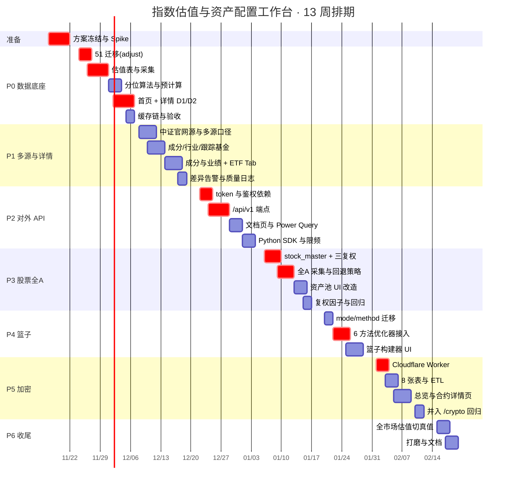
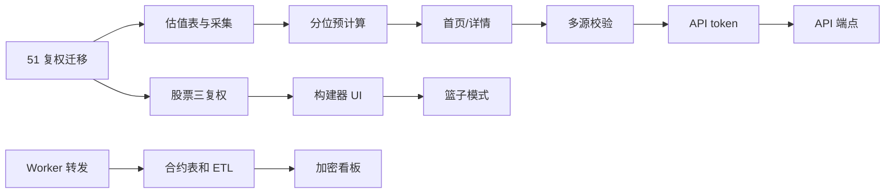

# 工程排期与项目管理

> 基准：2026-11-17 开工，13 周，2027-02-19 收尾。按「单人 + AI 协作」估算；关键路径已标出。

## 1. 甘特图

## 2. 里程碑

| 里程碑 | 日期 | 交付判据 |
|---|---|---|
| M0 方案冻结 | 2026-11-21 | 本套文档确认；3 个 Spike 通过 |
| M1 P0 数据底座 | 2026-12-05 | 521 指数日更成功；首页与详情可用；NAV 零漂移 |
| M2 P1 多源 | 2026-12-19 | 多源差异可查；两个 Tab 可用；质量日志有数据 |
| M3 P2 API | 2027-01-02 | token 签发可用；Excel 拉通；文档页上线 |
| M4 P3 股票 | 2027-01-16 | 全 A 三复权可查询；构建器可选口径 |
| M5 P4 篮子 | 2027-01-29 | 6 方法可跑；约束校验通过 |
| M6 P5 加密 | 2027-02-12 | 30 合约 5min 落库；看板可用 |
| M7 P6 收尾 | 2027-02-19 | 全市场估值可用；Lighthouse ≥ 90 |

## 3. 依赖关系

**关键路径**：`51 迁移 → 估值采集 → 分位 → 首页/详情 → 多源 → API`。任何一环延期直接挤压后续。

## 4. 缓冲与风险预算

- 每期预留 **1 天缓冲**（已含在 13 周内）；
- P3（全 A）与 P5（跨境）各额外留 1 天，若 Spike 不通过则启用降级方案；
- 若总工期被迫压缩，优先砍 P6，其次 P4 的「风险预算」，**P0/P2 不可砍**。

## 5. 角色分工（当前团队 = 1 人 + AI）

| 事项 | 人做 | AI 做 |
|---|---|---|
| 产品决策 / 口径确认 / 验收 | ✔ | 提供选项与证据 |
| 数据源账号、Cloudflare 凭据、部署授权 | ✔ | 不接触明文 |
| 代码实现 / 测试 / 文档 | 审核与合并 | 起草与执行 |
| 上线窗口 / 回滚决策 | ✔ | 给检查清单 |

## 6. 周会节奏

- 每周一次 15 分钟：本周交付、阻塞、下周计划；
- 每期结束一次「验收演示」：跑验收命令 + 截图 + 数据核对表；
- 变更控制：任何新增需求先进 backlog，不插队当期。